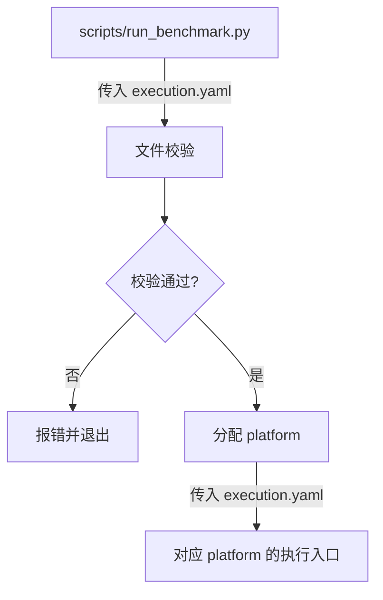
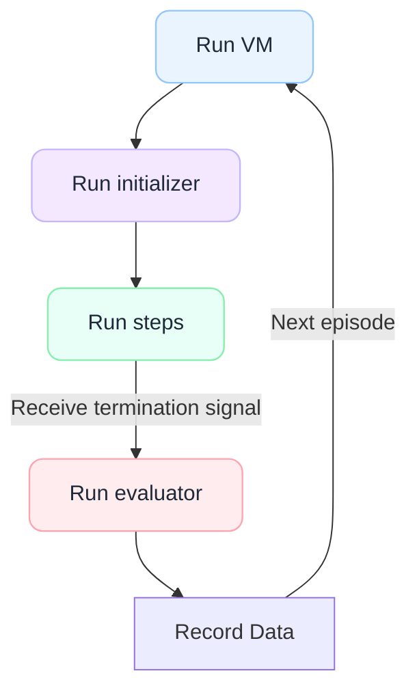
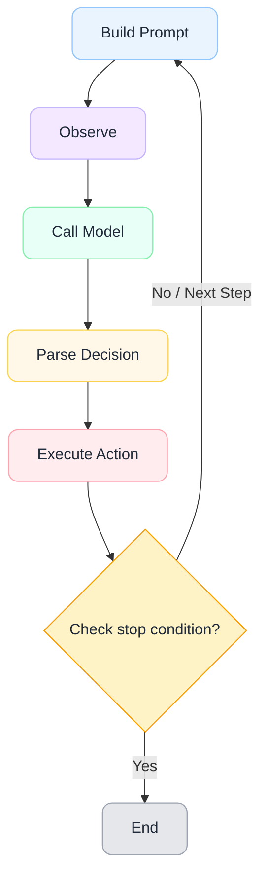

# Lifecycle

一次实验依赖以下输入：

- `execution.yaml`
- `task.yaml`
- `configs/models.yaml`
- 平台默认 runtime 配置（`configs/<platform>.yaml`）

其中：

- `execution.yaml` 定义本次实验的任务集合、模型集合和执行配置
- `task.yaml` 定义单个任务的内容，以及初始化和评测入口
- `models.yaml` 定义 `model_id` 到真实模型配置的映射
- 平台默认 runtime 配置由平台定义和读取

### execution

一次实验的顶层输入，对应一个 `execution.yaml` 文件。

一个 `execution` 定义：

- 要跑哪些 `task`
- 要跑哪些 `model`
- 本次运行的公共配置

启动后，会由`run_benchmark.py`校验并分配平台。

### episode

平台需要读取自己的运行时配置，然后把`execution` 展开为多个 `episode`。

展开方式是：`tasks x models`

也就是说，每个 `task` 都会分别和每个 `model` 组合，形成独立 `episode`。

一个`episode`的典型结构如下

`episode` 会在Steps传递出终止条件后结束。

`episode`的`step`循环停止后，系统会进入最终`evaluation`阶段，对 episode 的最终结果给出统一评测结论。

`episode` 结束后，应该写入该 `episode` 的过程产物，用于后续查看、调试和汇总。

### step

`episode` 在执行过程中会不断循环推进，每一轮循环就是一个 `step`。

一个 `step` 的典型结构如下：

`step` 会在满足条件后结束。

终止条件通常包括：

- agent 返回终止信号，如 `success` 或 `fail`
- 达到 `execution` 设定的步数或时间预算上限
- 当前 `step` 中出现无法继续恢复的异常
- 当前 `step` 的模型输出无法继续解析或执行

